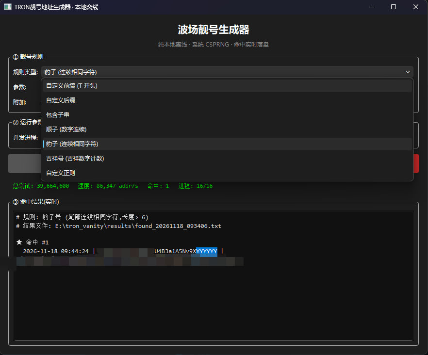

<h1>🔑 TRON Vanity · 波场靓号地址生成器</h1>

<h3>纯本地离线 · CPU 多进程极速碰撞 · 灵活自定义靓号规则</h3>

---

  

---

> 📌 **声明**：本工具仅限学习与科研用途，严禁用于任何违法违规行为，使用者须自行承担全部责任。
>
> 📌 **注意**：本工具仅发布打包后的 Windows 桌面版，请确保从本页面官方渠道下载，请勿从第三方来源获取，以免造成损失。

---

## 🧩 功能概览

| 模块 | 能力描述 |
|:----:|:---------|
| 🛡️ **安全可靠** | 核心算法基于标准密码学库，私钥与地址一一对应，完全匹配，可直接导入钱包 |
| 🌐 **纯本地离线** | 全程无任何网络请求，无需联网，私钥绝不外传，保障资产安全 |
| 🚀 **多进程加速** | 充分利用 CPU 多核性能，进程独立死循环碰撞，速度拉满 |
| 🎯 **丰富的规则** | 支持前缀/后缀/包含/顺子/豹子/吉祥号/正则表达式等 7 种匹配模式 |
| 💾 **实时落盘** | 命中后实时保存至本地文本文件，防止数据丢失，保障成果 |
| 🎨 **直观的 GUI** | 现代化暗黑主题界面，实时监控生成速度、命中数及进程状态 |
| ⚡ **优雅启停** | 停止时瞬间响应，界面不卡顿，可立即开启新一轮碰撞 |

---

## 💻 运行环境与安装

### 快速安装（Windows）

1. 前往本仓库的 **Releases** 页面下载最新版 `TRON-Vanity.zip`。
2. 将压缩包解压到任意英文路径下（**路径请勿包含中文、特殊字符及空格**）。
3. 双击运行 `TRON靓号生成器.exe` 即可。

> 💡 绿色免安装，无需配置 Python 环境，解压即用。

### 最低配置要求

| 项目 | 要求 |
|:----:|:-----|
| 操作系统 | Windows 10 / 11 (64-bit) |
| 处理器 | 支持多核运算的 CPU（核数越多，速度越快） |
| 运行库 | [Visual C++ Redistributable (x64)](https://aka.ms/vs/17/release/vc_redist.x64.exe) |

> ⚠️ **注意**：如果双击无反应或闪退，请优先检查是否安装了最新的 Visual C++ 运行库。

---

## 📖 详细使用教程

### 🚀 第一步：启动程序

双击 `TRON靓号生成器.exe` 打开主界面。

---

### ⚙️ 第二步：参数设置

界面分为清晰的几大区域：

| 配置项 | 说明 | 推荐值 |
|:------:|:-----|:------:|
| **规则类型** | 选择你要生成的靓号模式（前缀、后缀、豹子等） | 自定义后缀 |
| **参数** | 输入具体的匹配字符（如 `8888`、`LOVE` 等） | 8888 |
| **附加** | 动态显示长度、大小写、是否仅在尾部等细节选项 | 视规则而定 |
| **并发进程** | 参与运算的 CPU 核心数 | 默认本机 CPU 核数 |
| **保存目录** | 命中结果的保存位置 | `./results` |

---

### 🎯 第三步：规则详解

#### 1. 自定义前缀（T 开头）
生成以你指定字符开头的地址。例如输入 `TLaoli`，会生成 `TLaoli...` 格式的地址。
> 💡 注意：波场地址必须以 `T` 开头，程序会自动为你补全。

#### 2. 自定义后缀
生成以你指定字符结尾的地址。输入 `8888`，会生成 `...8888`。
> 💡 后缀位数越高，难度呈指数级增长。建议先用 3-4 位测试。

#### 3. 包含子串
地址中任意位置包含你输入的字符串即可命中（可选择是否区分大小写）。

#### 4. 顺子 / 豹子
- **顺子**：连续递增或递减的数字（如 `1234`、`9876`）。
- **豹子**：连续相同的字符（如 `8888`、`aaaa`）。
> 💡 勾选「仅在尾部」时，只匹配地址末尾；取消勾选则匹配任意位置。

#### 5. 吉祥号
计算地址中特定吉祥数字（如 `8`、`6`、`9`）的总出现次数，达到设定阈值即命中。

#### 6. 自定义正则
进阶玩家专属，输入正则表达式（如 `^T.*8888$`）进行精准匹配。

---

### 📊 第四步：实时监控与结果

点击 **「▶ 开始碰撞」** 按钮，状态栏将实时显示：
- **总尝试**：已尝试的私钥数量。
- **速度**：当前每秒尝试次数（addr/s）。
- **命中**：已生成的符合条件的靓号数量。
- **进程**：当前活跃的工作进程数（确保未意外退出）。

命中结果会实时显示在下方「命中结果」区域，并同步写入本地文件：
`results/found_时间戳.txt`（格式：`时间 | 地址 | 私钥`）。

---

### 💾 第五步：停止与导出

点击 **「■ 停止」** 按钮，程序会瞬间停止碰撞并释放 CPU，界面不会卡顿。你可以随时修改规则并重新点击开始。

> ⚠️ **安全提示**：私钥非常重要，请务必安全保存，不要泄露给任何人！

---

## 💡 新手必读与性能建议

### ⭐ 难度预估（基于 CPU 多进程）

由于纯 CPU 运算，速度受限于单机性能。假设 16 进程速度约为 `80,000 addr/s`：

| 后缀长度 | 组合数量 | 16进程预估时间 |
|:--------:|:--------:|:-------------:|
| 3 位 | 约 19.5 万 | 瞬间 |
| 4 位 | 约 1130 万 | 2 ~ 3 分钟 |
| 5 位 | 约 6.6 亿 | 2 ~ 3 小时 |
| 6 位 | 约 380 亿 | 数天 |

**建议流程：**
1. 先用「后缀 4 位」测试，确认程序能正常输出。
2. 确认正常后，再根据需要提高位数（建议不要超过 5 位，否则耗时极长）。

---

## 🔓 安全说明

🔓 零后门 — 可自行使用杀毒软件扫描验证，代码完全透明
🌐 零联网 — 全程离线运算，无任何网络请求
📤 零上传 — 私钥仅存于本地，绝不外传
🆔 抗爆破 · 不可复现 — 依托机器唯一标识技术，私钥派生强依赖本机硬件指纹，他人无法复现或爆破
✅ 地址校验 — 私钥与地址一一对应，完全匹配，无需多签机制，节省链上手续费，可直接导入任意波场钱包（如 TronLink、imToken 等）